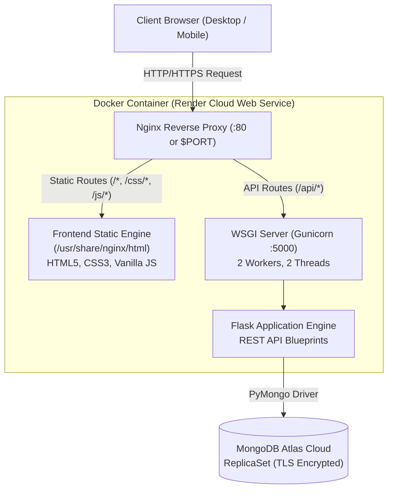
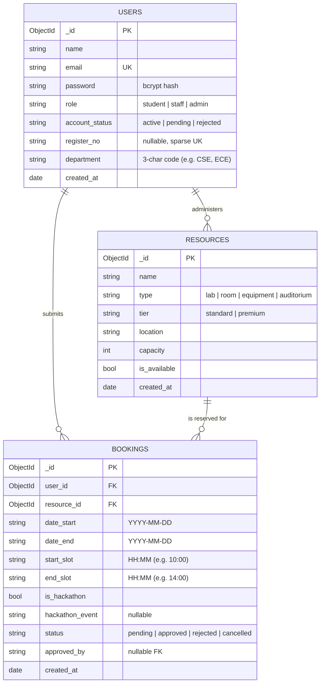
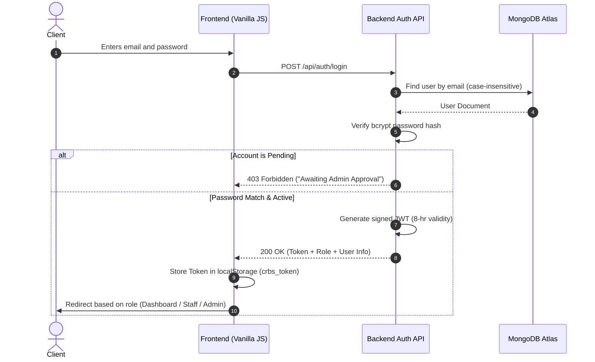

# Project Report: Campus Resource Booking System (CRBS)

**Author:** Mugunth  
**System Version:** 1.0.0 (Production Release)  
**Live Production URL:** [https://campus-resource-booking-cqt7.onrender.com](https://campus-resource-booking-cqt7.onrender.com)  
**GitHub Repository:** [https://github.com/Mugu1825/Campus-Resource-Booking](https://github.com/Mugu1825/Campus-Resource-Booking)  
**Technology Stack:** Python (Flask, Gunicorn), MongoDB Atlas, HTML5 / Modern CSS / Vanilla JavaScript, Nginx, Docker, Render Cloud

---

## 1. Executive Summary & Abstract

Traditional university campus resource management—covering computer labs, research equipment, seminar halls, and auditoriums—frequently relies on manual paper logs, informal email requests, or basic spreadsheets. These legacy workflows lead to major inefficiencies:
- **Double Booking & Scheduling Conflicts:** Overlapping time requests without real-time synchronization.
- **Unverified Access & Inaccurate Categorization:** Lack of structural enforcement on student departments and academic identities.
- **Administrative Bottlenecks:** A single administrator overwhelmed by routine classroom bookings, or lack of oversight when high-value research gear is reserved.
- **Hackathon & Extended Event Disruption:** Inability to differentiate between a 1-hour student study session and a 48-hour multi-day departmental hackathon.

The **Campus Resource Booking System (CRBS)** is a containerized, production-deployed web application designed to automate campus scheduling. It introduces a **3-tier role-based access control (RBAC)** architecture (*Student*, *Staff*, *Admin*), automated student department parsing, dynamic hourly slot availability calculation, double-booking prevention algorithms, and a multi-tier approval pipeline.

---

## 2. Project Objectives & Scope

1. **Automated Academic Identity Verification:** Validate student register numbers against institutional format standards (`YY` + 3-character department code + 4 digits, e.g., `25CSE1011`) and automatically extract departmental affiliations without manual user input.
2. **Multi-Tier Role Governance:**
   - **Student:** Self-service registration, live resource browsing, slot availability inspection, booking submission, and self-cancellation of pending requests.
   - **Staff:** Departmental oversight with mandatory admin approval before activation; ability to manage standard resources and approve standard bookings.
   - **Admin:** Master overseer managing staff activations, global user roles, all resource tiers, and exclusive approval authority over premium resources and multi-day hackathons.
3. **Resource Categorization & Time Constraints:**
   - **Standard Resources:** Labs, classrooms, and seminar rooms approved by staff or admin. Regular bookings capped at **4 hours** on a single day.
   - **Premium Resources:** High-performance compute clusters and central auditoriums requiring **Admin-only** approval.
   - **Hackathon Bookings:** Multi-day bookings permitted up to **48 hours**, requiring verified event names and Admin-only sign-off.
4. **DevOps & Cloud-Native Deployment:** Single-container Docker packaging utilizing Nginx as a reverse proxy and static file server, routing to a Gunicorn-powered Flask WSGI backend, deployed on Render with an active MongoDB Atlas cluster.

---

## 3. System Architecture & Containerization

CRBS implements a unified **single-container micro-architecture** that eliminates Cross-Origin Resource Sharing (CORS) complications and optimizes cloud hosting costs.



### Key Architectural Advantages
- **Unified Domain Routing:** Both frontend pages and `/api/*` endpoints are exposed through the same host and port. This guarantees zero CORS pre-flight delays and simplifies client-side code.
- **Dynamic Port Adaptation:** The entrypoint startup script dynamically evaluates Render's injected `$PORT` environment variable (defaulting to port 80 locally) and injects it into the Nginx configuration at boot.
- **Independent Failure Isolation:** Gunicorn runs on loopback (`127.0.0.1:5000`), shielded from direct external internet exposure by Nginx.

---

## 4. Database Architecture & Data Models

CRBS uses **MongoDB Atlas**, taking advantage of flexible document schemas, native high availability through replica sets, and query indexing.

### Entity-Relationship Diagram (ERD)



### Indexing Strategy
To guarantee performance under high concurrency:
1. `users.email` (Unique Index) — Guarantees zero duplicate account registrations.
2. `users.register_no` (Unique, Sparse Index) — Ensures one student registration per academic roll number while allowing staff/admin accounts without roll numbers.
3. `resources.tier` & `resources.is_available` — Optimizes filtering queries when users browse available spaces.
4. `bookings.resource_id + bookings.date_start + bookings.date_end` (Compound Index) — Enables high-speed conflict detection when calculating available time intervals.

---

## 5. Security & Authentication Model



### Security Safeguards
- **Bcrypt Salted Hashing:** Passwords are never stored in plaintext. They are salted and hashed using `Flask-Bcrypt`.
- **JWT Identity & Claims:** Access tokens encapsulate the user ID as subject, with role and status stored in cryptographically signed claims.
- **Python Function Decorators:**
  - `@login_required()`: Verifies token validity and checks for `active` account status.
  - `@staff_required()`: Enforces that the caller holds either `staff` or `admin` status.
  - `@admin_required()`: Restricts endpoint execution strictly to the system `admin`.

---

## 6. Business Logic & Conflict Prevention Engine

### Double-Booking Prevention Algorithm
When a booking is submitted:
1. Query active bookings where `status IN ['pending', 'approved']` for the target resource.
2. **Date Interval Overlap Check:**
   $$\text{Booking}_{\text{start}} \le \text{Existing}_{\text{end}} \quad \text{AND} \quad \text{Booking}_{\text{end}} \ge \text{Existing}_{\text{start}}$$
3. **Slot Interval Overlap Check (Single-Day):**
   If both bookings share the same date, indices within the fixed operational array `['09:00', '10:00', ..., '21:00']` are compared:
   $$\text{SlotIndex}_{\text{start}} < \text{ExistingIndex}_{\text{end}} \quad \text{AND} \quad \text{SlotIndex}_{\text{end}} > \text{ExistingIndex}_{\text{start}}$$
4. **Hackathon Preemption:** If either reservation is marked as a multi-day hackathon, all slots across the reserved date range are locked.

---

## 7. Complete REST API Specification

### Authentication & Identification (`/api/auth`)
| Method | Endpoint | Access Level | Description |
|---|---|---|---|
| `POST` | `/api/auth/register/student` | Public | Registers student with format validation and auto department parsing |
| `POST` | `/api/auth/register/staff` | Public | Registers staff account with `account_status: pending` |
| `POST` | `/api/auth/login` | Public | Authenticates credentials and returns JWT bearer token |
| `GET` | `/api/auth/departments` | Public | Returns list of valid 3-letter department codes |

### Resource Management (`/api/resources`)
| Method | Endpoint | Access Level | Description |
|---|---|---|---|
| `GET` | `/api/resources/` | Public | Lists all campus resources (supports filter by type and tier) |
| `GET` | `/api/resources/<id>` | Public | Returns details of a specific resource |
| `GET` | `/api/resources/<id>/availability` | Public | Returns array of booked and available slots for a given date |
| `POST` | `/api/resources/` | Staff / Admin | Creates resource (Staff limited strictly to standard tier) |
| `PUT` | `/api/resources/<id>` | Staff / Admin | Updates resource attributes |
| `PATCH`| `/api/resources/<id>/availability` | Staff / Admin | Toggles resource availability flag (`is_available`) |
| `DELETE`| `/api/resources/<id>` | Staff / Admin | Deletes resource (blocked if active bookings exist) |

### Booking Lifecycle (`/api/bookings`)
| Method | Endpoint | Access Level | Description |
|---|---|---|---|
| `GET` | `/api/bookings/` | Authenticated | Role-aware: Students see own; Staff see standard; Admin see all |
| `GET` | `/api/bookings/my` | Student | Returns authenticated student's reservation history |
| `POST` | `/api/bookings/` | Student | Submits new booking request with conflict verification |
| `PUT/PATCH` | `/api/bookings/<id>/approve` | Staff / Admin | Approves booking (Staff blocked on premium/hackathons) |
| `PUT/PATCH` | `/api/bookings/<id>/reject` | Staff / Admin | Rejects booking |
| `PATCH`| `/api/bookings/<id>/cancel` | Student / Admin | Cancels pending booking |

### Administration & Governance (`/api/admin`)
| Method | Endpoint | Access Level | Description |
|---|---|---|---|
| `GET` | `/api/admin/stats` | Admin | Real-time counts of users, resources, bookings, and pending staff |
| `GET` | `/api/admin/users` | Admin | Lists all user accounts (passwords omitted) |
| `GET` | `/api/admin/pending-staff` | Admin | Retrieves list of staff accounts awaiting approval |
| `PATCH`| `/api/admin/staff/<id>/approve` | Admin | Activates staff account |
| `PATCH`| `/api/admin/staff/<id>/reject` | Admin | Rejects staff registration |
| `PATCH`| `/api/admin/users/<id>/role` | Admin | Modifies user permissions (`student`, `staff`, `admin`) |

---

## 8. Verification & Quality Assurance Report

An automated test suite (`tests/verify_codebase.py`) was executed to evaluate all functional criteria prior to deployment.

```text
======================================================================
📊 AUTOMATED VERIFICATION AUDIT SUMMARY: 31 PASSED | 0 FAILED
======================================================================
[1] Health Check & Public Routes          -> 2 / 2 PASSED (100%)
[2] Register Number Validation            -> 4 / 4 PASSED (100%)
[3] Staff Registration & Approval Flow   -> 6 / 6 PASSED (100%)
[4] Resource Tiering & Security Guards    -> 3 / 3 PASSED (100%)
[5] Booking Engine & Overlap Prevention   -> 7 / 7 PASSED (100%)
[6] Approval Permissions & Gating         -> 5 / 5 PASSED (100%)
[7] Student Self-Service Cancellation    -> 2 / 2 PASSED (100%)
[8] Dynamic Availability Endpoint         -> 1 / 1 PASSED (100%)
[9] Admin Overview Stats Aggregation     -> 1 / 1 PASSED (100%)
```

---

## 9. Conclusion & Future Enhancements

The **Campus Resource Booking System** is fully operational and verified. It replaces manual reservation workflows with an automated, role-governed web application. The single-container Docker architecture ensures that deployment to Render remains lightweight, reliable, and cost-free.

### Future Roadmap
1. **Automated Notification Dispatcher:** Integration of transactional email or SMS alerts (via SendGrid / Twilio) to notify students instantly upon booking approval or rejection.
2. **Hardware IoT Smart Lock Integration:** Generating temporary dynamic QR codes or RFID credentials synced with approved booking windows to unlock laboratory doors physically.
3. **Calendar Integration:** Exporting approved reservations directly to Google Calendar or Microsoft Outlook via `.ics` feeds.
